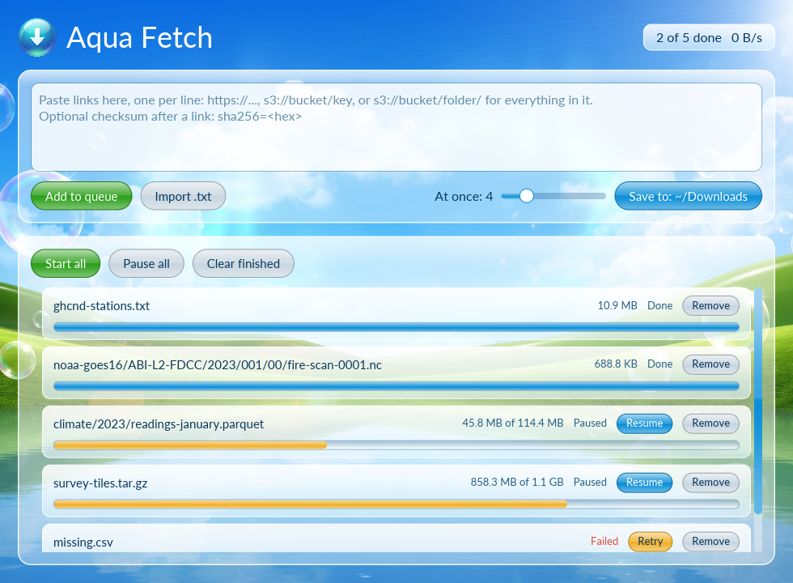

# Aqua Fetch

A small desktop download manager for fetching many files at once, with a Frutiger Aero look. Paste a list of links and it works through them, several at a time.



## What it does

- Downloads any direct HTTP(S) link, 1 to 16 at a time.
- Understands public S3 links: `s3://bucket/key` for one object, or `s3://bucket/folder/` to queue every object under that prefix, keeping the folder layout. The usual `https://bucket.s3.region.amazonaws.com/...` forms work too.
- Resumes partial files after a pause, crash or dropped connection, and retries failures three times.
- Checks a SHA-256 when you give one.
- Remembers the queue between runs.
- Imports links from a text file.

It only fetches direct links, where the URL itself returns the file. It does not handle private S3 buckets, logins, or file-hosting pages that need a browser.

## Install

Needs a Rust toolchain. On Linux:

```bash
./install.sh
```

This builds the app and installs it for your user, without sudo: the program to `~/.local/bin/aqua-fetch`, plus a menu entry and icon under `~/.local/share`. To uninstall, delete those three files.

To run it without installing:

```bash
cargo run --release
```

## Adding links

One link per line. Blank lines and lines starting with `#` are ignored, and links already in the queue are skipped.

```
https://example.org/data/2023.csv
s3://my-bucket/reports/summary.parquet
s3://my-bucket/raw/2023/
https://example.org/big.tar.gz sha256=<64 hex characters>
```

The same format works for **Import .txt**.

## Where things go

- Files are saved to the folder shown on the **Save to** button (default `~/Downloads`). S3 folders are saved as `<bucket>/<key>` under it.
- A download in progress is written to `<name>.part` and renamed when it is complete and verified.
- An existing file is never overwritten; a new download with the same name gets ` (1)` added.
- If a listed S3 object is already on disk with the same size, it is marked done, so re-adding a data set only fetches what is missing.
- The queue is stored in `$XDG_STATE_HOME/aqua-fetch/queue.json` (usually `~/.local/state/aqua-fetch/`).

## Known limits

- Very large S3 listings (tens of thousands of objects) make the window sluggish.
- A single `s3://` file in a bucket with dots in its name, outside us-east-1, fails with HTTP 301. Listing that bucket works.
- S3 keys containing `.` or `..` path parts are skipped.
- The text uses the Lato font when it is installed and falls back to the system default otherwise.

## Development

```bash
cargo test
cargo clippy --all-targets
```

Built with [iced](https://iced.rs). The background and icon in `assets/` were generated with Gemini; the originals are in `assets/source/`.
